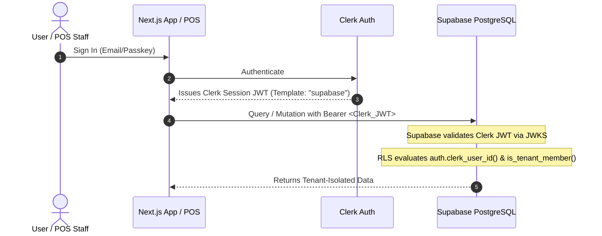

# RestroNex — Approved Technology Stack & Architecture Specification

> **APPROVED ARCHITECTURE DIRECTIVE**  
> This specification defines the fixed, non-negotiable technology stack and architectural standards for the RestroNex Restaurant POS SaaS across all development phases.

---

## 1. Approved Technology Matrix

| Component | Approved Technology | Function & Enforcement |
|:---|:---|:---|
| **Application Layer** | **Next.js 16 (App Router) + TypeScript** | React Server Components, Server Actions, route handlers, strict TypeScript validation. |
| **Primary Transactional Database** | **Supabase PostgreSQL** | Single source of truth for tenants, outlets, employees, subscriptions, orders, menus, inventory, and ledger. |
| **Authentication & Identity** | **Clerk** | Sole authentication provider. Employs Clerk's native third-party authentication integration with Supabase. |
| **Payment Gateway** | **Razorpay Only** | All customer payments, subscriptions, upgrades, and billing. Verified server-side via HMAC-SHA256 signatures. |
| **Object / File Storage** | **Supabase Storage** | Tenant-specific assets (logos, menu images) and private documents (invoices, tax records, day-end exports). |
| **Database Security** | **PostgreSQL Row Level Security (RLS)** | Kernel-level data isolation enforcing tenant-level and outlet-level authorization policies. |
| **Connection Pooling** | **Supavisor** | High-concurrency transaction pooling on port `6543` for serverless route handlers and edge environments. |
| **Database Migrations** | **Supabase CLI** | Version-controlled declarative SQL migrations in `supabase/migrations/` synced to remote branches. |

> [!CAUTION] Strict Prohibitions
> Do **NOT** introduce MongoDB, Firebase, Stripe, PayPal, AWS Cognito, or any other competing database, authentication provider, or payment gateway into this codebase.

---

## 2. Clerk & Supabase Native Integration

Clerk operates as the sole identity provider. Supabase relies on Clerk's native third-party JWT authentication:



### Clerk JWT Template Configuration
In the Clerk Dashboard (**JWT Templates** → **New Template** → **Supabase**):
```json
{
  "aud": "authenticated",
  "role": "authenticated",
  "email": "{{user.primary_email_address}}",
  "app_metadata": {
    "provider": "clerk"
  },
  "user_metadata": {
    "tenant_id": "{{user.public_metadata.tenant_id}}"
  }
}
```

### Database Claim Resolver
Supabase decodes Clerk's JWT natively via the helper function:
```sql
CREATE OR REPLACE FUNCTION auth.clerk_user_id() RETURNS TEXT AS $$
  SELECT NULLIF(current_setting('request.jwt.claims', true)::jsonb->>'sub', '')::text;
$$ LANGUAGE sql STABLE;
```

---

## 3. Multi-Tenant Authorization Model

RestroNex enforces multi-tier security at both the **Tenant Level** and **Outlet Level**:

### 1. Tenant-Level Isolation
Every operational table (`Tenant`, `Outlet`, `MenuItem`, `Order`, `InventoryItem`, `Customer`, `Subscription`, `Table`) carries a `tenantId`. RLS policies prohibit any operation where the authenticated user is not an active member of that tenant:
```sql
CREATE POLICY tenant_isolation_policy ON "Order"
    FOR ALL USING (
        public.is_tenant_member("tenantId") OR public.is_platform_admin()
    );
```

### 2. Outlet-Level Authorization
Staff accounts (`CASHIER`, `KITCHEN`, `WAITER`, `OUTLET_MANAGER`) are bound to specific `outletId`s inside `Membership`. RLS ensures staff cannot view or alter orders, cash drawers, or kitchen tickets belonging to a different branch:
```sql
CREATE POLICY tenant_outlet_isolation_order ON "Order"
    FOR ALL USING (
        public.is_tenant_member("tenantId") AND (public.has_outlet_access("outletId") OR public.is_platform_admin())
    );
```

---

## 4. Supabase Storage Architecture

Tenant files are organized into dedicated buckets with deterministic folder hierarchies:

1. **`restaurant-assets` (Public Read / Authenticated Tenant Upload):**
   - Path: `${tenantId}/logos/${filename}`
   - Path: `${tenantId}/menu/${filename}`
2. **`restaurant-documents` (Private RLS-Gated Read / Write):**
   - Path: `${tenantId}/reports/${filename}`
   - Path: `${tenantId}/receipts/${filename}`

Storage policies verify that `(storage.foldername(name))[1]` equals a `tenantId` the authenticated user belongs to.

---

## 5. Razorpay Payments & Webhook Security

- **Order Creation:** Initialized server-side only (`/api/checkout/create-order`) with accurate minor-unit (paise) integer math.
- **Verification:** Completed payments must supply `razorpay_order_id`, `razorpay_payment_id`, and `razorpay_signature`. The server validates using `crypto.createHmac('sha256', RAZORPAY_KEY_SECRET)` before activating any subscription or order.
- **Webhook Idempotency:** Webhook events are logged in the `WebhookEvent` table with a unique index on `eventId`. Duplicated delivery attempts return `200 { deduped: true }` without repeating side effects.

---

## 6. Connection Pooling (Supavisor)

For serverless deployments (such as Vercel or cloud containers), connection pooling is mandatory:
- **Application Pooler (Port 6543):** Set `DATABASE_URL` to Supavisor transaction mode (`...pooler.supabase.com:6543/postgres?pgbouncer=true`).
- **Migration & DDL (Port 5432):** Set `DIRECT_URL` to direct session mode (`...pooler.supabase.com:5432/postgres`) when running Prisma migrations or Supabase CLI commands.

---

## 7. Database Backups, Migrations & Disaster Recovery

- **Automated Backups:** Supabase automated daily WAL-level backups with Point-In-Time Recovery (PITR) for enterprise resiliency.
- **Versioned Migrations:** All schema changes reside in `supabase/migrations/` and `prisma/migrations/`.
- **Security Audits:** Regular execution of `npm run test:security` validates tenant boundaries, outlet access constraints, and webhook deduplication.
